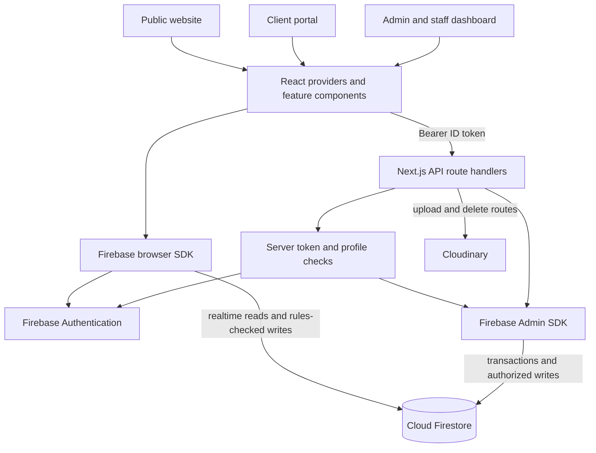

# Architecture Design

**Immediate email dispatch follow-up (2026-11-09):** Successful booking/payment route transactions now schedule only their newly-created deterministic outbox job IDs through Next.js 16 `after()` for best-effort post-response processing. The same claim/lease/retry worker is reused; failures do not change the committed business response and remain available to the approximately five-minute GitHub Actions fallback. No inbox receipt timing is guaranteed or claimed without an owner-authorized production test.

**Email/verification follow-up (2026-11-09):** New email/password signup is OTP-first: the server-only pending-registration state stores sanitized profile fields and HMAC-bound OTP state, while Firebase Auth and `users/{uid}` are created only after successful verification. The original password is held only in the globally mounted client `AuthProvider` ref across the client-side transition; after OTP success the browser automatically creates the Firebase identity and calls the protected finalizer, which atomically creates the Client profile and consumes a short-lived HttpOnly authorization. A refresh or interruption loses that nonpersistent handoff and safely requires signup restart. `/verify-email` supports paste-safe code entry, resend cooldown, automatic finalization status, retry/restart recovery, sign-out, and an explicit Firebase link fallback for existing authenticated accounts. Pending and authenticated OTP challenges are server-only, expire, lock, rate-limit, prevent replay, and never store plaintext codes; Firebase Auth remains authoritative for the legacy authenticated path. Protected Client mutations pass `requireVerifiedClient` to server authorization; the optional rollout boundary separately governs unmarked legacy password accounts. `lib/email-outbox.ts` records deterministic, sanitized jobs in the same Admin transaction as committed booking/payment/lifecycle transitions; `lib/email-worker.ts` claims jobs with leases, resolves recipient addresses from Firebase Auth, applies preview or explicitly enabled production allowlist policy, retries transient SMTP errors, and records terminal failure/block states. The `emailOutbox`, OTP, pending-registration, and registration-index collections are explicitly browser-denied. The guarded lifecycle API and Admin UI can reject only unsecured pending bookings without payment activity and enqueue the corresponding notification. The checked-in GitHub Actions worker is owner-controlled by a separate false-by-default repository-variable gate and is not activated by this repository. See [docs/EMAIL_SETUP.md](docs/EMAIL_SETUP.md); no scheduler activation or email activation was performed.

Source reviewed: **2026-10-19** baseline; resource identity, scheduling, maintenance, and CMS persistence rechecked **2026-10-25**; exclusive office occupancy and customer/admin Booking Details rechecked **2026-10-26**; payment verification/persistence/recovery rechecked **2026-10-27**; Phase 1 authorization, cent-level payment validation, refund ledger checks, lifecycle idempotency, and password reauthentication rechecked **2026-10-28**; compact booking/payment tables rechecked **2026-11-03**; protected portal/admin shell scrolling and F-01 booking-write authorization rechecked **2026-11-04**; CMS responsive/accessibility surfaces, Phase 2.1 table scrolling/admin booking ordering, and lifecycle/payment presentation rechecked **2026-11-05**; Phase 5 release-readiness validation, REF-01 refund authorization, CHAT-01 cursor pagination, baseline response hardening, client loading/New Booking recovery, and Defense Polish 2.2 accessibility/chat-read resilience rechecked **2026-11-06**; Admin Dashboard Payment Position removal, natural content-flow cleanup, Client Chat Firestore index hotfix, and Defense Polish 2.5 booking schedule controls/history rechecked **2026-11-07**. Start with [README.md](README.md) for setup and routes, and [DESIGN_PALETTE.md](DESIGN_PALETTE.md) for UI conventions.

Defense Polish 2 direct administrative booking modification/cancellation workflows and their local browser/API regressions were rechecked **2026-11-06**. Direct cancellation is Admin-only and computes existing refund eligibility without processing a refund; staff with `bookings` permission retain direct modification access.

Defense Polish 2.1 (**2026-11-06**) changes only presentation: compact admin actions, a padded Modify dialog with one body scroller and explicit keyboard focus return, a single projected admin booking-table status, aligned payment-list badges/actions, title-only main page headers, and removal of the Client Dashboard Payment Overview. Recent Payments, readiness guards, canonical calculations, APIs, permissions, and persistence contracts are unchanged.

The 2026-11-07 booking-list follow-up keeps persisted confirmed rows labeled `Confirmed` and adds only presentation-level `Rejected` filtering and active sort direction indicators.

**Defense Polish 2.5 (2026-11-07)** separates the direct Admin modification contract from the broader client request contract. `admin_update` accepts only `eventName`, `date`, `startTime`, and `endTime` from the request body; derived canonical time/date fields may still be generated server-side. The transaction rechecks exact resource identity, catalog bookability, capacity, availability, shared locks, and hold expiry before committing. On a successful effective schedule change it preserves the first trusted `originalSchedule`, records `originalScheduleCapturedAt`, and appends a `scheduleHistory` revision containing the previous/current schedule, Manila-readable source fields, timestamp, and actor metadata. No-op, rejected, and failed transactions do not create history. Client request `originalBookingSnapshot` remains temporary review state and is cleared after approval/decline. Admin Modify Booking exposes one unified screen with read-only booking context, the restricted Event Name field, a client-style availability calendar/time selector, current/proposed comparison, and server-backed conflict feedback; shared Admin/Client Booking Details render the original/current schedule, and Admin renders the complete revision list. Contract signing remains the same action with a full-width Admin footer-grid placement.

Defense Polish 2.2 (**2026-11-06**) adds semantic named toolbars with screen-reader-only page headings, explicit loading/error announcements, responsive Staff Management and Users Information table/card renderers, and labeled keyboard/focus states for the 360° tour. Chat read paths preserve the existing authorization scope while classifying errors, keeping canonical missing-index failures visible, and suppressing stale scope/generation callbacks; equality-only reads remain limited to legacy timestamp-less record discovery.

Defense Polish 2.2.2 (**2026-11-07**) is presentation-only: the public `TourButton` keeps its dark premium panel and existing catalog/selection/panorama behavior while using accessible shared orange/slate foreground utilities for venue and office card capacities, icons, descriptions, tab states, and interactive focus/expanded states. No booking capacity, pricing, or scheduling calculation changes.

The Admin Dashboard presentation-only cleanup removes the Payment Position card group, its helper note, and its empty toolbar spacing. Recent Bookings, Needs Attention, and Total Records remain in the natural content flow; `calculateAdminDashboardMetrics()`, readiness guards, provider streams, navigation, APIs, permissions, and Firestore persistence are unchanged.

The Client Chat index hotfix adds the minimum `chatMessages` collection-scope composite index for `clientId ASCENDING`, `timestamp DESCENDING`, and `__name__ DESCENDING`. Existing ascending history and sender/read indexes remain unchanged. The local manifest is not a deployment; project `oneestela-ae9b5` still requires an authorized index deployment and build completion before the production query can use it.

**Follow-up (2026-11-07):** Notification records accept Firestore, serialized, ISO, Date, and numeric timestamp forms for presentation and ordering; unrecoverable dates remain visibly undated. The client booking toolbar, below-`xl` payment record renderers, admin status/filter/sort presentation, and Reports control/summary layout were rechecked as presentation-only changes; canonical status, authorization, persistence, and financial helpers remain unchanged.

## System shape

One Estela Place is a **modular Next.js application** with client, admin, and shared feature modules. It combines realtime browser reads with authenticated server APIs for booking/payment workflows. Some supporting features still write directly to Firestore under security rules.



The server runs in the Next.js application; there is no separate backend service in this repository. APIs using Firebase Admin, Cloudinary, and contract filesystem access require a Node.js-capable deployment.

## Directory responsibilities

| Location | Responsibility |
| --- | --- |
| `app/(client)/` | Public `/` page; layout adds the contact-message provider |
| `app/portal/` | Client dashboard pages and authenticated navigation shell |
| `app/(admin)/` | Admin/staff navigation shell, `/dashboard/*`, and `/users` |
| `app/api/` | Server authentication, validation, transactions, and integration endpoints |
| `src/modules/client/components/` | Reservation dialogs, tour, contracts, and client feature UI |
| `src/modules/client/contexts/booking-context.tsx` | Booking/payment types, page-scoped subscriptions, action orchestration, and legacy normalization |
| `src/modules/client/lib/venue-data.ts` | Public catalog normalization and in-memory CMS catalog cache |
| `src/modules/admin/components/` | Reusable booking-management UI, booking/payment dialogs, and `cms/` editors |
| `src/modules/admin/contexts/` | CMS and staff state; also older report/payment-proof adapters |
| `src/modules/shared/auth/` | Firebase auth context and login/signup UI |
| `src/modules/shared/contexts/` | Active Firestore chat and notification providers |
| `src/modules/shared/components/ui/` | Shared Radix/shadcn-style UI primitives |
| `src/modules/shared/lib/` | Shared business calculations, availability, permissions-related helpers, uploads, formatting, and unit tests |
| `lib/firebase.ts` | Browser Firebase app/auth/database initialization and IndexedDB cache |
| `lib/firebase-admin.ts`, `lib/server-auth.ts` | Server-only Admin SDK, API authorization, and verification rollout enforcement; staging requires a matching explicit Admin project identity |
| `lib/email-config.ts`, `lib/email-transport.ts`, `lib/email-templates.ts` | Server-only Gmail/OTP configuration and transport plus sanitized branded notification rendering |
| `lib/email-otp.ts` | Server-only OTP generation, HMAC challenge storage, cooldown/rate limits, atomic claims, delivery, and Firebase Auth synchronization |
| `lib/pending-registration.ts` | Server-only OTP-first signup challenge, authorization cookie binding, delivery state, and idempotent Auth/profile finalization |
| `lib/email-outbox.ts`, `lib/email-dispatch.ts`, `lib/email-worker.ts` | Transactional outbox jobs, scoped post-response dispatch, idempotency, leases, retries, recipient resolution, and delivery state |
| `firestore.rules`, `firestore.indexes.json` | Browser data-access policy and composite indexes |
| `public/contracts/` | Static venue/office contract previews |

Import aliases from `tsconfig.json`: `@/*` resolves from the repository root; `@admin/*`, `@client/*`, and `@shared/*` resolve into their feature modules. `components.json` retains older generator aliases, so use existing module imports as the reference when adding UI.

`scripts/start-staging.mjs` is the isolated local staging entry point. It parses `.env.staging.local` directly, shadows all keys discovered in Next.js dotenv candidates before spawning Next.js, reapplies only the approved staging values, clears the dedicated `.next-staging` output, rejects the production Firebase project, and requires staging-only Admin credentials. If staging OTP sending is enabled, it additionally requires `EMAIL_OTP_STAGING_APPROVED=true`, one exact test-recipient allowlist address, a strong OTP secret, and complete staging Gmail settings while transactional email and verification enforcement remain disabled. `scripts/verify-staging-runtime.mjs` then probes the running browser bundle and server diagnostic without creating accounts or accessing data. It never loads `.env.local` as a Firebase source and does not deploy Firebase resources.

## Provider and state design

`app/layout.tsx` mounts `src/modules/shared/components/global-provider.tsx`:

```text
AuthProvider
├── PresenceTracker
└── ChatProvider                  shared/contexts/chat-context.tsx
    └── BookingProvider           client/contexts/booking-context.tsx
        └── NotificationProvider
            └── CMSProvider
                ├── route content
                └── Toaster
```

- The admin layout adds `StaffProvider` around its page content.
- The public `(client)` layout adds `MessageProvider` from `components/message-context.tsx`; that contact-message store uses localStorage and is separate from the active support chat.
- `AuthProvider` separates identity restoration, server-confirmed profile/permissions loading, ready/signed-out state, and initialization errors. `session-initialization.ts` coalesces login/listener profile reads and guards them by identity/generation; cancelled/late work cannot publish another account's state. Profile initialization fails closed for invalid roles/inactive profiles. Valid roles are `admin`, `staff`, and `client`.
- Pages opt into booking datasets through `useBookingData({ bookings, payments, officeRentals, maintenance })`. Only requested datasets have active listeners; hook cleanup unregisters exactly the datasets that caller requested.
- Booking/payment data is immediately masked and cleared when identity or relevant permissions change. Client queries use `userId` for bookings and `customerId` for payments; staff/admin queries depend on module access. One unordered listener per requested dataset includes legacy rows without date fields, with local presentation sorting; payments no longer require a duplicate recovery query. Stable need-count booleans prevent another consumer from restarting the same active listeners.
- Initial data readiness requires a server-confirmed snapshot (`includeMetadataChanges`); a cache-only empty event cannot finish loading. Dataset failures/initial-read deadlines expose aggregate `dataError`/`retryData` plus keyed `dataErrors`; synchronous listener/query failures are converted to the same safe error state instead of leaving `isLoading` set forever. Page consumers can fail closed only for the datasets they own, while maintenance-specific state remains in the maintenance modal. Dashboard pages use `dashboard-data-readiness.ts` to require both booking and payment sources before calculating financial summaries: authoritative empty snapshots remain valid zero totals, but failed or partial reads render an unavailable state until recovery. Transient terminal listener failures get one bounded read resubscription; obsolete callbacks are ignored. `DataLoadNotice` provides recovery inside protected layouts without unmounting the requesting consumers. Dashboard New Booking/Book Now actions navigate with the one-time `/portal/bookings?newBooking=1` UI intent; My Bookings consumes and clears that intent while opening one controlled existing ReserveDialog, including during loading/error states. My Bookings does not subscribe to maintenance records merely to render its booking list.
- The maintenance listener has no `orderBy` or arbitrary oldest-500 limit: legacy rows without `createdAt` and old blocks covering future dates must remain visible. It exposes separate loading/error state; a failed listener is not an empty, available schedule.
- Chat surfaces load through `loadChat()` and release through `unloadChat()`. A client or selected admin conversation keeps a latest bounded realtime page, while `loadOlderMessages()` retrieves older records through bounded cursors and stable document IDs. Admins use a bounded conversation index plus a bounded legacy lane for records without valid timestamps. Canonical ordered/index failures classified as Firestore `failed-precondition` remain visible and retryable until the declared composite indexes are deployed; no equality-only result is presented as complete canonical history and permission failures never broaden the query. Unread listeners request one bounded probe page and display `500+` when the probe may be incomplete; read-state updates process bounded pages without counting outgoing messages. Optimistic read-state recovery is guarded by account scope and history generation so stale failures cannot roll back a later conversation. Notification queries are bounded to 100 records.
- Firestore's browser cache uses shared multi-tab IndexedDB persistence where available; the SDK can fall back to memory when persistence is unsupported. This avoids the reproduced single-tab exclusive-ownership warning. Cache contents never authorize a profile or confirm initial private data readiness.
- Notification presentation uses the shared timestamp normalizer for Firestore, serialized, ISO, Date, and numeric values, keeps missing dates honest, and offers an accessible disclosure for long messages. These are display behaviors; notification routing, read state, and the 100-record query bound remain unchanged.

## Identity and authorization

1. Browser sign-in uses Firebase Authentication email/password.
2. `getAuthHeaders()` in `src/modules/shared/lib/auth-token.ts` waits for Firebase identity restoration, attaches its ID token, and rejects token results from an obsolete identity. Safe-read waits are bounded/cancellable; booking/payment writes are never automatically replayed by this helper.
3. `requireAuthenticatedUser()` verifies the token, including revocation checks, and reads the current Firestore profile. Missing/invalid roles and inactive profiles are rejected. The server finalizer creates new Client profiles with the immutable `emailVerificationRequired` marker; that marker blocks new unverified email/password Clients from protected mutations, while only the OTP route opts out so existing authenticated accounts can complete verification. Other protected Client callers can additionally require a current Firebase Auth email-verification check; the optional rollout boundary fails open when not configured, and legacy/federated accounts are not unexpectedly locked out.
4. `requireBackofficeUser()` adds admin/staff restrictions, module-permission checks, or `adminOnly` access.
5. Browser Firestore operations are independently enforced by `firestore.rules`. Firebase Admin bypasses those rules, so route handlers enforce authorization and ownership themselves.

Staff permission keys are `dashboard`, `bookings`, `chat`, `payments`, `reports`, `cms`, and `users`. Staff defaults enable only `dashboard`; staff administration is admin-only. Sidebar visibility and client redirects provide navigation behavior; API checks and Firestore rules enforce data access.

Login navigation uses the Next router after the profile is ready; logout invalidates session state and lets the protected guards navigate. Neither flow forces a page reload. `SessionInitializationNotice` distinguishes identity/profile loading from a genuine initialization failure and offers Retry/Sign out. Guard redirects wait for initialization and do not replace a profile error with a blank page or a signed-out redirect.

Browser rules deny booking creation/deletion and permit only the top-level descriptive metadata allowlist (`eventName`, `eventType`, and `specialRequests`) for admins or staff with `bookings` permission. Ownership/customer identity, canonical resource IDs, schedule/date/term fields, lifecycle/secured state, price, amount paid, payment/refund data, audit fields, timestamps, nested maps, and unknown fields are server-authoritative for every browser identity. All browser writes to `maintenanceRecords` and the unused legacy `officeRentals` workflow are denied; allocation changes must use checked server APIs, not the retained browser lease editor.

Password changes stay client-side through `AuthProvider.updatePassword`: email/password accounts must provide a nonempty, different current/new password, reauthenticate with Firebase, and only then call `updatePassword`. Federated or passwordless accounts are rejected rather than being given a weaker flow. Email profile changes use the same recent-password requirement before the server profile update.

## Persistence and relationships

| Collection / document | Purpose and important links |
| --- | --- |
| `users/{uid}` | Profile, role, active status, staff permissions, contact details, presence timestamp, and client-only `chatSuggestionState` visibility metadata; matches Firebase Auth UID |
| `cms/data` | Public website content, venues, offices with nested rooms, policies, payment instructions, contract references, and `bookingCounter` |
| `chatSuggestionQuestions/config` | Protected CMS-managed question/answer records, publication flags, stable IDs, status groups, priorities, and revision metadata; readable only by CMS-authorized backoffice users |
| `chatSuggestionQuestions/published` | Server-maintained question-only publication projection; never contains configured answers and is not directly readable by customer browsers |
| `chatSuggestionQuestions/publishedVersion` | Small customer-readable publication revision marker; contains no question or answer content |
| `bookings/{id}` | Venue or office reservation; owner is `userId`; resource identity uses `venueId`, `officeId`, and `spaceId` |
| `payments/{id}` | One document per payment submission; joins via `bookingId`/`bookingCode`, client owner via `customerId` |
| `receipts/{receiptNumber}` | Transaction receipts linked to a booking and, for the per-payment flow, a `paymentId` |
| `maintenanceRecords/{id}` | Full-day/date-range blocks with explicit `venue`, `room`, or `building` scope and canonical resource IDs |
| `eventAvailabilityLocks/{hash}` | Server-only resource revision locks: venue/date for events; `office:<parent ID>` / `all-dates` for every room in an office building |
| `chatMessages/{id}` | Client-scoped support messages, sender metadata, attachments, and read flags |
| `notifications/{id}` | Booking/payment updates; client UID or shared `"admin"` audience with permission-filtered staff access |
| `emailOutbox/{jobId}` | Server-only sanitized transactional email job keyed by deterministic event ID; browser reads/writes are denied |
| `emailOtpChallenges/{uid}` | Server-only active/expired/verified OTP challenge metadata and digests; browser reads/writes are denied |
| `emailOtpRateLimits/{scope}` | Server-only account/email/IP OTP issuance counters; browser reads/writes are denied |
| `pendingEmailRegistrations/{registrationId}` | Server-only OTP-first signup profile fields, digest, delivery state, and single-use finalization state; browser reads/writes are denied |
| `pendingEmailRegistrationIndex/{emailDigest}` | Server-only normalized-email-to-pending-registration lock/index; browser reads/writes are denied |
| `reviews/{id}` | Authenticated reviews; creation requires ownership of a completed booking |
| `officeRentals/{id}` | Legacy lease/check-payment records retained as availability inputs; browser writes are frozen |
| `paymentProofs/{id}`, `contracts/{id}` | Supporting/older document paths retained by components and rules |

Booking documents also retain `paymentReceipts`, a latest `receipt`, lifecycle/request metadata, and bounded admin logs. Payment/receipt joins use IDs and booking codes, not customer or venue display names. Historical records use multiple field/status shapes; shared helpers normalize them. Schedule revisions use the trusted `originalSchedule`, optional `originalScheduleCapturedAt`, and append-only `scheduleHistory` fields; each revision contains only schedule snapshots plus timestamp/actor metadata. `originalBookingSnapshot` is temporary client modification-review state, not permanent schedule history.

Uploaded asset URLs/public IDs are returned by Cloudinary. Some existing chat/proof paths also accept or store data URLs. Firebase Storage is present in web configuration but is not the upload backend used by the current upload APIs.

## API map

All authenticated paths below map to `app/api/<path>/route.ts` and require a Firebase Bearer ID token; the internal worker instead uses `CRON_SECRET`. Admin access satisfies staff permission checks.

| Endpoint | Methods | Responsibility / authorization |
| --- | --- | --- |
| `/api/availability` | GET | Authenticated, read-only schedule projection; sanitized intervals, office `scope=rooms` occupancy badges, optional full office term/bounded maintenance-start search, authorized self-exclusion, successful responses `private, no-store` |
| `/api/bookings` | POST | Client-only booking creation with catalog, date, capacity, room, price, and availability validation |
| `/api/maintenance` | POST, DELETE | Bookings permission: atomically create scoped full-day blocks or delete explicit record IDs; creation rejects schedule conflicts |
| `/api/bookings/lifecycle` | POST | `complete`, `status`, `contract_signed`, `balance_reminder`: bookings permission; `issue_receipt` and `expire`: owning client |
| `/api/auth/email-otp` | POST | Authenticated Client OTP issue/resend/verify; UID and email come from the verified Firebase token, not the request body |
| `/api/auth/register/otp` | POST | Unauthenticated OTP-first signup issue/resend/verify/status; profile fields are sanitized server-side and no Auth/profile is created here |
| `/api/auth/register/finalize` | POST | Firebase ID token plus HttpOnly registration authorization; Admin SDK marks Auth verified and atomically creates/acknowledges the Client profile |
| `/api/bookings/cancellation` | POST, PATCH | Owning client requests cancellation; bookings staff/admin approve or decline; `admin_cancel` is an Admin-only transactional direct cancellation using the existing secured/paid/lead-time eligibility policy |
| `/api/bookings/modification` | POST | Owner request; bookings staff/admin review or perform `admin_update`. Client requests retain the broader existing allowlist, while direct Admin updates accept only `eventName`, `date`, `startTime`, and `endTime`; successful schedule changes transactionally preserve `originalSchedule` and append `scheduleHistory`, with availability checks, actor/value audit metadata, and client notification |
| `/api/bookings/refund` | POST | Owner requests a refund; bookings staff/admin complete it; both steps validate the received-money ledger and are idempotent |
| `/api/payments/submit` | POST | Client-owned payment submission, amount/type validation, proof/reference checks, and transaction receipt creation |
| `/api/payments/review` | GET, POST | Payments permission: POST reviews an explicit payment document; GET reads that submission's authoritative saved state for uncertain-response reconciliation (`private, no-store`) |
| `/api/payments/onsite` | POST | Bookings **or** payments permission: record and verify an onsite payment; the dashboard supplies an atomic retry key |
| `/api/profile` | PATCH | Update the authenticated user's email/phone; email changes enforce recent authentication |
| `/api/staff` | GET, POST, PATCH, DELETE | Admin-only Firebase Auth/profile administration |
| `/api/cloudinary/upload` | POST | Authenticated, folder-scoped upload with size/type/signature checks |
| `/api/cloudinary/delete` | POST | Authenticated, folder-scoped asset deletion |
| `/api/internal/email-worker` | GET, POST | `CRON_SECRET`-protected server-only Gmail outbox processing; deployment scheduler is owner-configured |
| `/api/internal/email-diagnostics` | GET, POST | `CRON_SECRET`-protected safe email/Firebase readiness diagnostics; no credentials, addresses, or secrets are returned |
| `/api/internal/staging-runtime` | GET | Local staging-only, token-gated diagnostic for client/Admin project IDs and disabled email controls; unavailable in production |
| `/api/contracts` | GET | CMS permission: list static files under `public/contracts/venue` or `public/contracts/office` |
| `/api/chat-suggestions/config` | GET, PATCH | CMS permission: read or transactionally save the protected predefined question configuration and published projection with revision conflict checks |
| `/api/chat-suggestions/published` | GET | Client-only, server-filtered current status category/top-three question metadata; answers and other categories are never returned |
| `/api/chat-suggestions/answer` | POST | Client-only, status/ownership-checked selected-question delivery; atomically records the customer question, optional trusted automated answer, and idempotency record |

Contract listing is authenticated; the listed files themselves are public `/contracts/...` assets.

### Email and verification data flow

Firebase `emailVerified` is the authoritative verification state. New signup first calls `/api/auth/register/otp`; this unauthenticated route accepts profile fields but stores only sanitized pending state and a digest-bound OTP, never a password, Firebase Auth identity, or Client profile. After OTP success it sets a short-lived HttpOnly authorization cookie. The browser uses the original password held only in the mounted `AuthProvider` ref, creates Firebase Auth, and calls `/api/auth/register/finalize`; the Admin transaction verifies the email-bound authorization, marks Auth verified, creates the Client profile, and consumes the authorization idempotently. Replaying the OTP after success cannot mint another authorization. A refresh loses the in-memory password and requires safe signup restart rather than persistent recovery. Existing authenticated signup/verification requests `/api/auth/email-otp`; that route derives UID/email from the verified token and is the only pre-verification authenticated exception. `/verify-email` reloads Firebase state for the legacy path, accepts a six-digit code or paste, and provides cooldown/rate-limit messaging, status refresh, automatic signup finalization, retry/restart recovery, and sign-out. Both OTP services never store plaintext codes: pending registration binds its HMAC to normalized email, code, and registration ID; the authenticated path binds its digest to UID, email, code, and challenge ID. Expiry, issuance limits, five-attempt locking, delivery-failure states, atomic transitions, and digest clearing prevent reuse. The Firebase link path remains available only when `NEXT_PUBLIC_EMAIL_VERIFICATION_LINK_FALLBACK_ENABLED=true`. The `emailVerificationRequired` profile marker classifies new signup onboarding but is not proof of verification; protected enforcement uses Firebase Auth state, provider identity, and `EMAIL_VERIFICATION_ENFORCEMENT_START_AT` for the legacy rollout boundary.

When `EMAIL_SENDING_ENABLED=true`, approved server transactions call `enqueueEmailEvent(s)` before their business writes are committed. Payment review and onsite verification batch all outbox reads before creating the separate deterministic `payment_verified` and first-transition `booking_confirmed` jobs, so both notifications commit with the payment transition. Explicit lifecycle approval continues to use `booking_approved`. The event ID is deterministic, so transaction retries and repeated lifecycle requests do not create duplicate jobs. The worker claims pending/retry jobs for five minutes, resolves `recipientUid` through Firebase Admin Auth, rejects invalid or non-allowlisted recipients, renders a versioned sanitized template, submits through Gmail SMTP, and updates `sent`, `retry`, `failed`, or `blocked` state. SMTP acceptance is not an inbox-delivery guarantee; an ambiguous timeout may be retried and can theoretically duplicate a message. Disabled environments create no jobs and do not replay historical transitions. OTP delivery is independent: `EMAIL_OTP_SENDING_ENABLED` plus `EMAIL_OTP_SECRET` controls it, and production additionally requires `EMAIL_OTP_PRODUCTION_APPROVED=true`; OTP messages are sent directly through the server-only Gmail transport and do not enter `emailOutbox`.

After the transaction commits, `lib/email-dispatch.ts` schedules Next.js 16 `after()` work with only the IDs reported as newly created by that transaction. It invokes the same worker with a document-ID scope, never scans historical outbox records, never sends inside the transaction, catches immediate failures, and leaves the committed job for the scheduled fallback. Immediate and scheduled workers can race safely because both use the existing claim transaction and lease guard.

## Core data flows

### Resource identity

`src/modules/shared/lib/resource-identity.ts` is the shared resolver for bookings, maintenance, and legacy rentals. New scheduling inputs use `getCatalogAvailabilitySpace()` with exact category/catalog IDs; an office room is the **parent office ID + room ID**, not a name, room number, or array position. Provider update helpers preserve IDs and accumulate rename aliases; archived identities remain in resolution so archiving cannot erase history or break an ambiguous tie.

`resolveResourceSpace()` checks exact, case-sensitive IDs first, then exact current names or explicit `legacyNames` aliases (labels normalize case and whitespace). Child references are scoped to the established parent. It never uses substrings, ID prefixes, inferred room numbers, render order, or customer event titles. Category comes from explicit booking/rental metadata, `isOfficeRental`, or `officeId`; maintenance uses its explicit `type`, and legacy rentals are office resources. `eventType` is descriptive/custom text, not resource identity; the reservation form has built-in options plus Other/free text, not a CMS event-type catalog.

Resolution returns `resolved`, `ambiguous`, or `unresolved`, never the first plausible match. Server scheduling rejects blocking ambiguous candidates affecting the target, and unresolved records with an exact target parent/resource link, with **409** for administrator review. Office reservations/leases apply across all dates; event and maintenance conflicts retain date scoping. Unanchored unresolved records still need an audit, not a guessed association. See [the identity audit/migration procedure](README.md#resource-identity-audit-and-migration); it is not a live scheduling writer.

### Reservation and availability

1. `reserve-dialog.tsx` reads the current CMS catalog and keeps venue/office/room selection by ID, preserving identity across renames and room reordering. Dashboard navigation opens it through the one-time My Bookings UI intent; the My Bookings controller remains mountable while client booking/payment reads are loading or failed. It requests availability through `availability-client.ts`.
2. `BookingProvider` sends booking input and auth headers to `/api/bookings`.
3. The server reads **persisted** `cms/data`, resolves the exact venue/office/room and catalog status, derives price/capacity, validates event guest count against the canonical catalog capacity, and validates the schedule. `under_renovation` venues and offices are visible catalog entries but cannot receive new allocations; an office-level block applies to every room.
4. A Firestore transaction checks bookings, maintenance, and relevant legacy office rentals through `readResourceAvailability()`, then atomically commits eligible hold expiries, advances `cms/data.bookingCounter`, and creates a `pending`, `unpaid` booking. `readResourceAvailabilityLock()` in `lib/event-availability-lock.ts` serializes booking creation, approved/admin modifications, and maintenance creation even when conflict reads were initially empty. Admin schedule changes use the same lock/recheck path and only append schedule history after the effective update is known to be nonempty and successful.
5. The server attempts an admin notification after creation. Scoped Firestore subscriptions refresh the client and dashboard.

Venue locks are per resource/date; venue maintenance ranges lock **every covered date**. Office locks use the parent building across **all dates and rooms**, so different rental start dates and room-versus-building maintenance still contend. This coarser office lock trades concurrency for correct term/building overlap checks; independent rooms can succeed after retry and recheck.

`lib/resource-availability.ts` deliberately scans complete, unordered collections of `bookings`, `maintenanceRecords`, and, for offices, `officeRentals`, then filters identity/dates. Until legacy migration is complete, narrow canonical-ID/date queries or limits could omit name-only, `startDate`-only, missing-`createdAt`, or undated rental records. **GET uses field projections** from `availability-read-fields.ts` to avoid transferring proof/receipt/profile payloads while retaining all identity aliases, lifecycle, time/term and hold-money inputs. Transactional writers still read full records, including historical audit logs. Ledger checks are pipelined with independent collection reads, and canonically protected holds avoid unnecessary ledger lookups using the same expiry predicate. No customer documents from those reads are returned by GET; do not optimize by dropping legacy blockers.

`getAvailabilityDateBounds()` in `availability.ts` prefers `date` over `startDate` and a persisted `endDate` over derivation. For office records with a recognized `officeRentalTerm`, `rentalTerm`, or `contractTerm`, it derives a missing end date using `getOfficeRentalEndDate()`: 6/12/24 calendar months, clamped to the destination month's last day. It does not invent an unknown term. Maintenance range endpoints are inclusive. **Ongoing office reservations and leases block their exact resource across all dates**, whether dated or undated; a planned/past end date never substitutes for an explicit lifecycle release. Canonical terminal states and server/ledger-approved unpaid hold expiry release only their own record; other reservations, leases, or maintenance still apply. Pending cancellation keeps occupancy.

The event schedule is fixed at **08:00–22:00**, exactly **6 hours** per reservation, with **hourly** starts (latest **16:00**). `hasEventTurnoverConflict()` in `availability.ts` requires exactly one **60-minute gap between bookings**, in either order; no extra hour is required after the final event. Catalog schedule overrides cannot bypass this event policy. The generic half-open overlap helper and office-exclusive lifecycle/date-scoped maintenance behavior remain separate.

GET `/api/availability` accepts at most 62 calendar dates and returns selected resource IDs plus per-date `status`, `availableSlots`, and `occupiedIntervals`. Event occupied intervals contain only numeric start/end minutes and formatted labels, sorted by start then end; no booking/payment/customer documents or their IDs leave the endpoint. Office/maintenance days have empty interval lists. Optional office `rentalTerm` evaluates the **entire term for each proposed start date**, not just that day. Successful responses send `Cache-Control: private, no-store`.

With an office `rentalTerm`, optional `searchFrom`/`searchTo` search at most **1096 inclusive start dates** separately from the 62-day visible calendar. GET reads maintenance through the last candidate's lease end and **all-date** office reservations/leases, applies ledger-based hold projection, and returns only `officeSearch: { from, to, earliestAvailableStartDate }` (date or `null`). Shared `findEarliestOfficeStartDate()` resolves exact parent/room IDs once, rejects ongoing reservations/leases, and jumps past conflicting inclusive maintenance ranges; `calculateAvailabilityRange(..., rentalTerm)` and allocation's `getAvailabilityRangeStatus()` use those same blocks. The shared `getMinimumBookingDate()` supplies the Manila one-calendar-month notice to search, form, and creation API, preserving the existing minimum-notice month rollover separately from clamped lease ends.

`use-office-room-availability.ts` fetches `scope=rooms` for the selected building before room selection. The server performs one complete building read and returns only `{ officeId, officeRooms: { [roomId]: status } }`: `available`, `reserved`, `occupied`, `maintenance`, or `unavailable`. Identity-review failures are isolated to affected room cards. Owner-scoped browser records cannot establish cross-customer availability. Reserved/occupied rooms stay visible and disabled, with no future-date flow; active legacy leases and canonical `active_rental` bookings remain blocked through contract signing/lease hand-off. Current maintenance and nonbookable rooms are also disabled. A newly blocked selected room clears pending confirmation and returns to room selection.

Available office selection starts with **6 Months** and opens the first month containing a valid complete term after date-scoped maintenance. The notice is **Earliest available start date**. Room/term changes recheck availability; invalid dates clear with an explanation. Manual previous/next navigation remains available. An empty maintenance search explicitly states its period and offers **Search later start dates**; each additional period is user-triggered and bounded. Both occupancy and calendar hooks invalidate on provider booking/maintenance/legacy-rental changes; other-session changes and clock-based hold expiry are picked up on focus and at 30-second polling. Failed/malformed responses keep selection/submission disabled. Creation and approved/admin modifications revalidate event capacity, ongoing exclusivity, and the complete term transactionally under the building-wide lock, including nonoverlapping future dates and stale tabs. Modification requests use the same capacity contract, and office bookings retain `guestCount = 1`.

For maintenance, admins and staff with `bookings` permission may request a whole building by setting office `spaceId` to its parent `officeId`; this aggregates every room in that building. Ordinary clients must select an exact room and cannot use whole-building lookup.

An ordinary client may use `excludeBookingId` only for an existing booking they own; missing/foreign exclusions return 403. **Current backoffice exception:** admins and staff with `bookings` permission may also exclude an existing booking, so this is not globally owner-only. Modification validation excludes its own booking and rechecks on approval.

`use-space-availability.ts` refreshes visible schedules every 30 seconds and on focus. Under **SELECT TIME**, the reservation UI shows compact occupied times/available starts only for a selected event date with intervals; no date or a genuinely empty date has no notice/placeholder. Loading and failure are separate states, never evidence of availability. Invalid event times clear; Proceed requires a current valid schedule, including the selected office term. Booking creation requires at least **one calendar month in advance**, using the Manila date.

Availability hooks wait for profile initialization and use primitive resource/room/month/term/exclusion keys, rather than catalog/object identity. `availability-client.ts` shares only identical in-flight GETs by UID, request, and invalidation revision; one cancelled consumer cannot abort another, while the last cancellation aborts transport. There is no completed availability cache. Known booking/lease/maintenance changes use compact scheduling/hold keys, excluding large proofs/receipts/notes; a new revision cannot join an obsolete in-flight read. Responses must match the requested resource and contain the complete date range. GET recovery is bounded, failed/unloaded responses stay unavailable, and callers retain Retry actions. `Server-Timing`/request IDs and opt-in client traces separate authentication, transport/database, calculation, and render work.

### Pending hold expiry

`booking-lifecycle.ts` defines the **24-hour** window. `evaluateAvailabilityHolds()` checks the server clock and the actual `payments` ledger joined by booking ID/code, not just stale unpaid aggregates or a browser timer. Only abandoned `pending` holds with no received money, pending submission, or verified payment are eligible. Secured/admin-verified/contract-signed bookings and payment/cancellation/modification review holds remain protected, including incomplete payments with received money. Terminal states release according to `booking-helpers.ts` and `availability.ts`.

Availability GET applies expiry as a **read-only projection**, without writes or notifications. Successful booking creation, maintenance creation, and approved/admin modification commits persist eligible expiries only for the affected resource (all dates for exclusive offices; the affected date window for events), in the same transaction as allocation/locks: `status: "cancelled"`, system automatic-expiry audit fields, and `AUTO_EXPIRE_BOOKING`. Failed transactions and modification requests do not persist those projected expiries; there is no global expiry sweep here. The owning-client lifecycle `expire` action uses the same eligibility predicate. Payment submission/onsite recording reject expired or released holds; payment review, status, and contract signing cannot reactivate a released reservation. A new availability-checked booking is required.

### Maintenance

`/api/maintenance` POST/DELETE requires admin or staff **bookings** permission, not CMS permission alone. POST validates persisted IDs and explicit `venue`, office `room`, or whole-`building` scope, Manila today-or-later dates, and at most 180 covered days per request. It assigns fresh `maint_<UUID>` IDs and server label/audit snapshots; one transaction locks/checks all selected resources/dates before any writes. Any ongoing office reservation/lease, overlapping event booking/existing maintenance, duplicate batch entry, or relevant ambiguous/unresolved legacy identity rejects the **entire batch**, rather than cancelling reservations.

DELETE atomically removes up to 500 distinct explicit IDs, including unresolvable legacy entries; any missing ID rejects the batch. This limit bounds a mutation, not listener results. Fresh IDs prevent a stale delete from removing a later replacement block for the same date/resource. Provider actions validate the returned records/IDs before local changes; the management UI awaits acknowledgement before clearing drafts or showing success, retains failed drafts/selections, surfaces errors, and disables mutations when maintenance loading fails. Its resource options come from CMS, not `lib/central-data.ts`.

The maintenance calendar uses the same sanitized server GET, including ledger-checked hold expiry and legacy-identity errors, rather than guessing from locally loaded payment/booking data. Booking, rental, and maintenance snapshots invalidate its request immediately; stale responses are aborted. Selections retained across month navigation are rechecked before submission, and POST still validates every date transactionally.

Schedule Maintenance has a viewport-bounded flex shell, fixed header/close and Block Date footer, and one `min-h-0 overflow-y-auto` body around its fieldset. Paginated existing records use that body rather than a nested scroller. The shared non-plain dialog surface inherits its caller's height cap; Radix owns background scroll locking and nested-dialog restoration.

### Payments and receipts

1. A client selects bank transfer or onsite cash. Bank transfer includes proof and a reference number; online office payments are slot-reservation payments only. `payment-reference.ts` supplies the form, booking provider, and submit API with one string-only validator: trim surrounding whitespace, preserve leading zeros, and require at least five ASCII numeric digits with no reference-specific maximum. Letters, punctuation, and internal whitespace are rejected. Cash requires neither a bank reference nor bank proof. Successful reference validation only permits submission for admin review; it never verifies payment or secures a booking.
2. `/api/payments/submit` checks ownership, payable state, pending submissions, and current amount due inside a transaction.
3. Each submission gets a new `payments` record and a transaction-linked receipt. The receipt number is linked back to the payment; booking receipt history is retained.
4. `/api/payments/review` applies verification/rejection/incomplete transitions, updates that transaction's receipt and booking aggregates, and notifies the client. `/api/payments/onsite` handles staff-entered onsite receipts/payments. Each new finalized review atomically persists a versioned `reviewSnapshot` on the payment and its own receipt.
5. Client, admin, receipts, and reports derive financial values through shared payment/report helpers.

Review persistence and recovery (rechecked **2026-10-27**):

- Review reads the exact selected payment document and validates booking/customer association. Booking display codes are ledger aliases, not document-ID substitutions. Amount validation uses the selected submission, never a booking-level amount fallback. A rejected submission contributes zero; incomplete received money remains credited.
- A booking's `receipt` and `paymentReceipts` must not duplicate large inline proof images from each full snapshot: repeated data URLs can exceed Firestore's **1 MiB per-document limit** even with three submissions. `buildBookingReceiptProjection()` keeps new inline-proof entries' immutable summary/note metadata in `reviewSnapshotSummary` plus an exact `reviewSnapshotRef`; full proof/snapshot evidence stays on `payments/{id}` and `receipts/{receiptNumber}`. Earlier finalized entries are left intact. Shared presentation resolves these summaries without inventing historical values and prefers the exact canonical full proof when loaded. Later receipt issuance uses the same projection helper.
- Payment review completes all reads (including the selected receipt) before writes. One transaction updates the selected payment, booking ledger, and its exclusively associated receipt. Changed top-level maps are replaced so a previous latest receipt's full snapshot cannot leak through a recursive merge. Shared legacy receipt-number links cannot overwrite another submission's receipt; verified retries acknowledge saved state without writes/notifications.
- `payment-review-client.ts` coalesces in-flight reviews per payment. Lost/invalid/5xx responses trigger a permission-checked, noncached GET; a user-initiated retry after uncertainty checks saved state again before another POST. Cache/event refresh failures after acknowledgement are logged separately and cannot turn a successful review into an action failure. Safe API errors reach the modal; response request IDs correlate server diagnostics.
- Later verification/rejection/incomplete reviews preserve already secured bookings, advanced office lease stages, and separate modification/cancellation workflows. The original DP requirement remains consistent with the credited receipt ledger.

Payment-review presentation (reviewed **2026-10-22**):

- Finalized views pass the historical snapshot transaction to `payment-review.ts` for note resolution. Pending/legacy selections resolve by stable payment ID, with the authoritative payment document winning even when its note is empty/missing; booking-level incomplete/rejection notes are never per-submission fallbacks. A legacy projection can supply its own note only with a payment ID. `rejectionReason` is used only when that record's populated review states all say rejected.
- Admin and client use `use-payment-history-selection.ts` to pin selection by ID across new/reordered snapshots. A disappearing selection shows an unavailable state instead of selecting a different submission. Review action forms mount per booking/payment/action and begin with fresh drafts.
- `buildFinalizedPaymentSnapshot()` captures stable booking/payment IDs, review-finalization time, original submitted amount, credited amount, outcome, note, proof, booking price, and the complete post-review credited/DP ledger. It runs with the full server ledger, not a submitted-time prefix. Earlier snapshots are never recomputed when later payments arrive; verified retries return without writing.
- `getReceiptPresentation()` is the shared historical resolver for admin, client, and booking receipt views. It prefers the selected payment's snapshot, then its exact receipt's snapshot. Receipt matching requires booking identity plus payment ID (or an exact legacy receipt-number link), never array position, submission label, timestamp proximity, or the latest receipt. The review API requires an explicit payment document ID. Snapshots resolve independently of the loaded history page. New records persist display-only `paymentNumber` labels.
- Legacy finalized records expose only historical values actually stored on their own finalized receipt; missing amounts/DP values explicitly show **Unavailable**. Current payment statuses and current booking prices are never used to fabricate a legacy historical ledger. Later receipt issuance preserves an existing snapshot and does not backfill an invented one.
- `calculateReceiptPaymentSummary()` remains a live booking-wide **credited** ledger, including incomplete received money and the original DP requirement. Pending selections explicitly label those live totals **Current Booking Summary**. Finalized selections use **Historical Payment Summary**. `calculateBookingVerifiedPaymentSummary()` remains a verified-only diagnostic.
- `receipt-paper.tsx` shows the selected transaction's submitted/credited amounts, historical booking/DP summary, and emphasized Total Unpaid Balance. `payment-review-details.tsx` supplies the same proof/note cards to both views; finalized notes/proof come from that snapshot. Submission status is separate from current overall booking payment status.

**Defense Polish 2.4 follow-up (2026-11-07):** The Admin Payment Verification modal filters only the visible Payment History list with the canonical method aliases `Bank Transfer` and `Pay at the Office` (plus `All Payments`). A method switch preserves an in-filter selection or chooses the first record in the existing stable history order; an empty filter clears the receipt area. `calculatePaymentSummary()` and `getReceiptPresentation()` continue to receive the complete booking submission ledger, and receipts remain exact payment-ID matches.

### Compact record tables (reviewed **2026-11-03**)

Admin Booking Management, Admin Payment Verification, Client My Bookings, and Client My Transactions use the shared table primitives in `src/modules/shared/components/ui/table.tsx` for compact semantic desktop/tablet rows. `getBookingScheduleClassification()` uses Manila calendar boundaries to distinguish `upcoming`, `active`, `completed`, `cancelled`, `rejected`, and `legacy` schedule states without changing stored lifecycle values. Admin booking rows project exactly one primary badge: rejected schedules say Rejected; confirmed lifecycle rows with a usable schedule show Upcoming, Active, or Completed; other rows use the canonical lifecycle label (including Confirmed when schedule data is unavailable). Client booking rows also project exactly one presentation-only status badge through the shared presentation mapping, while Booking Details retains separate lifecycle/schedule information. Payment rows expose unchanged canonical payment/review classifications in centered uniform badges; received/credited, verified, pending-review, and outstanding values remain separate. Related values are grouped into approximately five to seven meaningful columns, with wider identity/resource cells, a constrained financial summary, consistent action sizing, contained horizontal scrolling, and condensed labeled rows on mobile. Existing lifecycle filters, activity ordering, pagination, notification highlighting, ownership filtering, booking grouping, and detail/action workflows remain unchanged. Admin Booking Management applies `createdAt` descending to the complete authorized filtered dataset before pagination by default; its manual sorting and explicit newest-first reset remain presentation concerns.

Admin payment rows remain grouped by canonical booking ID/code. The latest submission amount/date and stable submission identifier are display context only; review actions still open the booking-level history modal and require the exact selected `paymentRecordId`/submission for Verify, Reject, Incomplete, or onsite workflows. Client transaction rows remain one financial summary per owned booking and derive received/credited, verified, pending-review, balance, and status values from `calculatePaymentSummary()`; pending and rejected submissions are not counted as received money, and full submission/receipt history remains in the existing details dialog. User-facing pending review labels use **Pending Verification**; persisted status values and review transitions are unchanged.

### Protected workspace scrolling (reviewed **2026-11-04**)

The client and admin layouts use a viewport-bounded flex shell with a fixed header, independently scrollable navigation, and a `min-h-0` content row/main pane. The main pane owns vertical page scrolling while the shared table primitive owns contained horizontal overflow and horizontal overscroll only; vertical wheel/touch scrolling chains to the main pane normally. Keep `min-h-0` on each constrained flex ancestor when changing these layouts; otherwise a browser may size the flex item to its content and clip the intended scroll surface. This is presentation-only and does not change route, provider, permission, or data behavior.

**Canonical ledger rules** in `payment-calculations.ts`:

- `acceptedVerifiedTotal` counts verified records only.
- `moneyReceivedTotal` / `acceptedTotalPaid` also credit money recorded as received on **incomplete** submissions. Pending/rejected claims add no received money.
- Remaining balances and downpayment completion use that received-money ledger. Preserve the distinction between received money and officially verified money.
- Individual transaction statuses stay independent of the aggregate booking status. An old incomplete payment remains incomplete after a later payment covers the downpayment.
- Keep one receipt identity per payment in the per-payment flow. Preserve legacy no-payment-record fallback behavior.

Request and ledger safety (rechecked **2026-10-28**):

- `parseCurrencyToCents()` is the strict request parser: it accepts finite nonnegative numbers or trimmed peso/grouped decimal strings with no more than two decimal places, then rejects malformed, negative-sign, exponent, and nonnumeric inputs. The routes additionally reject zero and amounts above `MAX_PAYMENT_AMOUNT_CENTS`. `toPaymentCents()` is deliberately more tolerant only when reading legacy stored values; all new validation, balance comparisons, and ledger arithmetic use integer cents before converting back to Firestore-compatible numbers.
- Submit, review, and onsite routes re-read the booking/payment ledger inside their transactions. They reject expired/released holds, duplicate pending submissions, overpayments, invalid downpayments, and review amounts above the submitted/current due amount. Online office submissions remain slot-reservation-only. Onsite callers may omit `idempotencyKey` for legacy compatibility, but the dashboard creates and reuses a stable key across retries; when present, `paymentIdempotency/{sha256(bookingId,key)}` stores the request fingerprint and payment/receipt IDs in the same transaction, returning the original result without creating money or notifications twice.
- Cancellation approval and refund request/completion re-read payments by booking ID/code inside their transactions. The refund amount is initialized/capped to the canonical `moneyReceivedTotal` (including received incomplete money), rejects ledger inconsistencies, and records the ledger amount used. Ownership is required for client requests, bookings permission for completion, and already-requested/already-refunded states return without a second state change or notification.
- Direct administrative cancellation uses `PATCH /api/bookings/cancellation` with `action: "admin_cancel"`. It is Admin-only, rejects unpaid/pending-verification, terminal, pending-cancellation, and active-modification states, rechecks the existing cancellation/refund eligibility policy inside the transaction, records `cancellationSource: "admin"`, `cancellationType: "admin_action"`, reason/actor/audit fields, and emits one client-scoped cancellation notification. It may set only the existing refund-eligibility projection; it never requests or completes a refund. Repeated cancellation requests acknowledge an already-cancelled booking without a second state change or notification.

### Booking modification safety and schedule history

- `/api/bookings/modification` keeps the client `request` allowlist and review flow for descriptive/event, schedule, and validated office-term changes. The direct `admin_update` branch has its own strict request allowlist: `eventName`, `date`, `startTime`, and `endTime`. Venue/resource IDs, guest count, tenant/company fields, rental terms, notes, lifecycle/payment fields, and unknown keys are rejected before any write.
- Admin event-name-only changes do not acquire or mutate schedule locks. Date/time changes build a trusted candidate, validate the Manila date and canonical six-hour slot, re-resolve the persisted catalog resource, recheck capacity/bookability/maintenance/holds/availability under the shared event or office lock, and commit only the four requested fields plus server-derived canonical fields and audit metadata.
- `buildBookingScheduleHistoryUpdate()` compares trusted effective snapshots. It captures `originalSchedule` only on the first successful effective schedule transition and appends one numbered `scheduleHistory` entry per later successful transition. No-op edits return without a booking write/history entry; validation, conflict, authorization, and transaction failures cannot append history. Admin and Client Booking Details use `booking-schedule-history.ts` and `booking-schedule-history.tsx` to normalize legacy time shapes and format dates/times for `Asia/Manila`.

### Lifecycle and action guards

`/api/bookings/lifecycle` keeps booking lifecycle separate from payment status and applies the following server-side guards transactionally:

- `complete` is idempotent and requires an active, availability-blocking booking with no remaining credited balance; released bookings cannot be completed.
- `status` is idempotent, allows secured states plus guarded `declined`, rejects backward lifecycle movement and unresolved cancellation/modification workflows, and requires the payment threshold for the resource (downpayment for events, full payment for offices). `declined` is limited to an unsecured `pending`/`verifying` booking with no received or pending payment activity; it releases availability, records an actor/reason audit field, creates `booking_rejected` notification/outbox records, and cannot be used to reject a paid or secured request. `contract_signed` is also idempotent, requires a secured active booking, and moves an office to `active_rental`.
- `balance_reminder` records a one-time sent marker and requires a positive current balance. `issue_receipt` reuses an existing receipt, while client `expire` uses the same 24-hour/ledger hold predicate as availability and only releases an eligible pending hold. Notifications are emitted only after a transaction reports a real state change.

### CMS publication

Admin CMS editor -> `useCMS()` mutation -> normalize/strip undefined values and identify changed sections -> transactionally read `cms/data`, reject stale conflicting sections, and `set(..., { mergeFields: changedKeys })` -> provider/catalog/policy caches and Firestore snapshots -> public page, booking UI, and tour.

Only CMS-owned top-level sections are written, preserving concurrent unrelated content, unknown fields, and the server-managed `bookingCounter`. The stale-section check rejects the whole save if an edited section differs from both its original state and the intended draft; it does not merge individual room edits. CMS content is publicly readable; write access is controlled by Firestore rules for admin/CMS staff. Missing content is seeded only on an explicit save, not on mount. See [CMS_ARCHITECTURE.md](CMS_ARCHITECTURE.md) for identity, fallback, editor, and persistence details.

Venue/office entries include optional `detailedDescription` alongside the short `description`. Both catalog normalizers preserve it; `shared/lib/space-description.ts` supplies the shared nonblank-full-text/short-text fallback. Tour thumbnails and booking-card photos expand details through Radix Collapsible; booking progression stays on the Select button. Schedule's expandable details resolve the latest CMS description by the selected space ID. The venue/office editors await their existing add/update operations' save result before closing.

### Reports and analytics

`app/(admin)/dashboard/reports/page.tsx` reports only canonical `bookings` and their exact `payments` joins; it does not import legacy `officeRentals` data or monthly-rent/deposit/cheque records. Booking category and resource filters use explicit booking metadata plus `resource-identity.ts` resolution against the CMS catalog, retaining unresolved records in broad views without assigning them to a guessed resource. One filtered booking dataset drives summaries, charts, the compact nine-column wide-desktop summary table, expandable complete record details, labeled narrower-width records, Excel export, and the existing print report; typed sorting and pagination affect presentation rows only, never the complete export/summary set. The on-screen summary is presentation-only: the existing fourteen Excel/print fields, including verified/refund/net-cash values, remain in the dedicated export/print projection. The accessible print-options dialog defaults to the established chart-inclusive output and can deliberately omit only the chart section; both modes retain the same metadata, summaries, filters, sorting, and complete filtered table. Office-only views leave the event-type chart non-applicable rather than treating office business-nature values as event types.

The Phase 1A financial reporting contract is explicit: **Total Booking Value** is the booking face value; **Received Payments** is `PaymentSummary.moneyReceivedTotal` (verified payments plus amounts recorded as received on incomplete payments); **Verified Payments** is `acceptedVerifiedTotal` only; **Processed Refunds** includes only `refunded`/`refund_claimed` statuses and prefers the completion field `refundedAmount` over the legacy/request field `refundAmount`; **Net Received Cash** is received payments less processed refunds, calculated once and never below zero; and **Outstanding Balance** remains the canonical payment-ledger balance, not revenue. Pending/rejected payments and pending/eligible refund requests do not affect received or net cash. Cancellations retain their existing lifecycle treatment. These values are shared by the dashboard, charts, report rows, Excel export, and print output. The term “Net Received Cash” is intentionally used instead of recognized revenue because the application does not implement accounting revenue-recognition rules.

### Chat and notifications

- The active support chat is `src/modules/shared/contexts/chat-context.tsx`, mounted by `GlobalProvider`. Components write messages/read flags through the browser SDK and subscribe within the permitted client/admin scope.
- Portal chat pages and the portal widget manage the lazy conversation listener. Keep that lifecycle intact when changing chat surfaces.
- Chat presentation is intentionally separate from storage: `chat-presentation.ts` performs stable-ID deduplication, deterministic ordering, same-sender/day grouping, and missing-timestamp safety; `time-format.ts` formats chat and notification timestamps in `Asia/Manila`. The chat scroll hook only follows new messages while the user is near the bottom and exposes a jump-to-latest action otherwise.
- Older-message controls preserve the visible scroll anchor, while near-bottom listeners continue to follow appropriate new messages. Legacy messages remain visible through a bounded document-ID fallback lane; records without a valid timestamp are rendered without fabricated chronological placement.
- Chat and notification listeners expose loading/error/retry state. Read mutations update both applicable flags and roll back optimistic UI state when a write fails; invalid notification links are ignored rather than navigated to.
- Status-aware customer suggestions use the deterministic selector in `chat-suggestions.ts`, the server-filtered `/api/chat-suggestions/published` response, and the owning client's `users/{uid}.chatSuggestionState` cooldown metadata. Customer browsers subscribe only to `chatSuggestionQuestions/publishedVersion`; the server then evaluates the authenticated customer's bookings/payments and returns at most the current status category's top three question-only records. They are rendered by the portal page/widget and are displayed/sent only after an explicit customer click.
- A selected question is delivered through `/api/chat-suggestions/answer`, which rechecks the current status category/top three, reads the protected answer, and transactionally writes `chatMessages` plus `chatMessageIdempotency`. Automated messages use `senderId: "automated-support"`, `senderName: "One Estela Place Support"`, and `isBot: true`; clients cannot create those messages through browser rules. Free-text messages never trigger this route and no LLM is involved.
- Notifications use `isRead` for the bell and `moduleRead` for module badges; read actions update both. Staff notification queries preserve permission-based type filtering, with internal `refund_requested` records restricted to administrators and staff with `bookings`; client-scoped `booking_updated`, `booking_cancelled`, and `refund_completed` records remain available only to their owning client.

## Business behavior to preserve

| Area | Implementation reference / invariant |
| --- | --- |
| Pricing | Server derives prices from stored CMS; default venue downpayment percentage is 50 when no valid override exists |
| Payment expiry | `booking-lifecycle.ts` + `lib/resource-availability.ts`: 24-hour server/ledger eligibility; GET projects without writes, successful scheduling transactions audit scoped expiry; secured/review/received-money holds stay protected |
| Cancellation | `cancellation.ts` requires a secured/paid booking, disallows terminal/duplicate requests and requests within 7 days, and handles cooldown/audit fields; Admin-only direct cancellation reuses this policy without processing refunds |
| Refunds | Cancellation approval helper uses a 14-day eligibility threshold and a 7-day onsite readiness date; preserve its current calculations unless policy changes are requested |
| Office rentals | One ongoing reservation/lease per exact parent/room across all dates and customers; terms are `6_months`, `1_year`, `2_years`; slot payment, physical contract signing, advance/deposit, and cheque tracking are distinct stages |
| Dates | Preserve date-only booking fields, ISO activity timestamps, and Manila-aware booking validation; inspect the relevant helper before changing date arithmetic |
| Statuses | `catalogStatus` (`published`/`under_renovation`), `status`, `bookingStatus`, `paymentStatus`, and request/contract statuses represent different concerns; use existing normalization and label helpers |

## Task-to-file map

Paths are relative to the repository root.

| Prompt concerns | Open first |
| --- | --- |
| Public page / header / footer | `app/(client)/page.tsx`, `src/modules/client/components/public-layout.tsx` |
| Client/admin navigation | `app/portal/layout.tsx`, `app/(admin)/layout.tsx` |
| Client booking entry points | `app/portal/page.tsx`, `app/portal/bookings/page.tsx`, `src/modules/client/components/reserve-dialog.tsx`, `scripts/verify-booking-navigation.mjs` |
| Login / OTP-first signup / profile | `src/modules/shared/auth/auth-context.tsx`, `lib/pending-registration.ts`, `app/api/auth/register/`, `src/modules/shared/lib/session-initialization.ts`, `src/modules/shared/lib/auth-token.ts`, protected layouts, `scripts/verify-initialization.mjs`, auth dialogs, `app/api/profile/route.ts` |
| Resource identity / aliases | `src/modules/shared/lib/resource-identity.ts`, `src/modules/admin/contexts/cms-context.tsx`, `src/modules/shared/lib/__tests__/resource-identity.test.ts` |
| Reservation / availability | `src/modules/client/components/reserve-dialog.tsx`, `src/modules/shared/hooks/use-space-availability.ts`, `src/modules/shared/lib/availability.ts`, `lib/resource-availability.ts`, `lib/event-availability-lock.ts`, `app/api/availability/route.ts`, `app/api/bookings/route.ts` |
| Maintenance | `app/api/maintenance/route.ts`, `app/(admin)/dashboard/bookings/page.tsx` (`MaintenanceCalendarModal`), `src/modules/client/contexts/booking-context.tsx`, `firestore.rules` |
| Hold expiry / released-state guards | `src/modules/shared/lib/booking-lifecycle.ts`, `lib/resource-availability.ts`, `app/api/bookings/lifecycle/route.ts`, `app/api/payments/`, `src/modules/shared/lib/__tests__/hold-expiry-api.test.ts` |
| Real Firestore scheduling verification | `src/modules/shared/lib/__tests__/availability-emulator.test.ts`, `src/modules/shared/lib/__tests__/firestore.rules.test.ts`, [combined local emulator command](README.md#development-commands) |
| Booking actions / status | `src/modules/client/contexts/booking-context.tsx`, `src/modules/shared/lib/booking-helpers.ts`, relevant `app/api/bookings/*/route.ts` |
| Client Booking Details | `app/portal/bookings/page.tsx`, `src/modules/client/components/booking-detail-fields.tsx`, `src/modules/client/components/booking-cancellation-details.tsx`, `scripts/verify-booking-details.mjs` |
| Booking Details action layout (customer/admin) | `src/modules/shared/components/booking-details-actions.tsx`, `app/portal/bookings/page.tsx` (Documents rows), `app/(admin)/dashboard/bookings/page.tsx` (management actions), `scripts/verify-booking-details.mjs`, `scripts/verify-payment-submission.mjs`, `scripts/verify-admin-booking-actions.mjs` |
| Admin modification and schedule history | `app/api/bookings/modification/route.ts`, `src/modules/admin/components/modify-booking-dialog.tsx`, `src/modules/shared/lib/booking-schedule-history.ts`, `src/modules/shared/components/booking-schedule-history.tsx`, `src/modules/client/contexts/booking-context.tsx`, `scripts/verify-admin-booking-actions.mjs`, `scripts/verify-booking-details.mjs`, `src/modules/shared/lib/__tests__/booking-payment-api.test.ts` |
| Payments / balances / receipts | `src/modules/shared/lib/payment-calculations.ts`, `src/modules/shared/lib/payment-verification.ts`, `src/modules/shared/lib/payment-review-client.ts`, `app/api/payments/`, portal/admin payment pages; `payment-review-api.test.ts` and `scripts/verify-payment-verification.mjs` for focused regressions |
| Payment reference / submission form | `src/modules/shared/lib/payment-reference.ts`, `app/portal/payments/page.tsx`, `src/modules/shared/components/bank-transfer-qr.tsx`, `app/api/payments/submit/route.ts` |
| Cancellation / refunds | `src/modules/shared/lib/cancellation.ts`, `app/api/bookings/cancellation/route.ts`, `app/api/bookings/refund/route.ts`, cancellation dialogs, `scripts/verify-admin-booking-actions.mjs` |
| CMS / catalog | `src/modules/admin/contexts/cms-context.tsx`, `src/modules/admin/components/cms/`, `src/modules/client/lib/venue-data.ts` |
| 360 tour | `src/modules/client/components/tour-button.tsx`, `panoImage` fields in CMS; reservation previews also live in `reserve-dialog.tsx` |
| Expandable space descriptions | Tour/reservation components above, CMS venue/office tabs, `src/modules/shared/lib/space-description.ts`, `src/modules/client/lib/venue-data.ts` |
| Chat / unread counts | `src/modules/shared/contexts/chat-context.tsx`, relevant chat page/widget, `src/modules/shared/contexts/notification-context.tsx` |
| Staff / access control | `src/modules/shared/types/permissions.ts`, `lib/server-auth.ts`, `app/api/staff/route.ts`, `firestore.rules` |
| Reports / Excel / printing | `app/(admin)/dashboard/reports/page.tsx`, `src/modules/shared/lib/report-calculations.ts`, `app/globals.css`, `scripts/verify-report-print.mjs` |
| Uploads | `src/modules/shared/lib/cloudinary.ts`, `app/api/cloudinary/`, feature-specific upload component |
| Shared styling | `app/globals.css`, `tailwind.config.ts`, `src/modules/shared/components/ui/`, [DESIGN_PALETTE.md](DESIGN_PALETTE.md) |

## Compatibility notes

- Root `components/` contains mixed implementations: `chat-context.tsx` is an older localStorage chat context, while the public contact `message-context.tsx` and payment-proof adapters still have imports. Trace imports before choosing or removing a file.
- `lib/central-data.ts` is an older static catalog, not the admin bookings/maintenance source; that page now uses CMS. `lib/mock-db.ts`, `src/modules/admin/contexts/report-context.tsx`, Supabase/socket stubs, and the alternate `virtual-tour.tsx` are not authoritative for the current server booking flow, reports, or CMS-driven tour.
- CMS policy text and starter predefined-answer copy are editable content, not substitutes for the enforced server/helper behavior. Trace both when a business-policy change is requested.
- CMS/profile/review/receipt paths retain some direct browser writes. Maintenance is server-only; legacy office-rental browser writers remain in source but are frozen by rules and are not the active booking path.
- CMS section transactions preserve `bookingCounter` and reject conflicting stale sections. Public normalization does not blacklist catalog names or append defaults to explicit empty/partial lists; missing-data fallbacks, including the legacy absent-room exception, are documented in [CMS_ARCHITECTURE.md](CMS_ARCHITECTURE.md#read-flow). Server scheduling never injects a default catalog.
- Test counts, lint counts, and audit notes in `IMPROVEMENTS.md` describe an earlier pass. Use current command output for current verification; a skipped emulator suite is not a rules validation pass.
